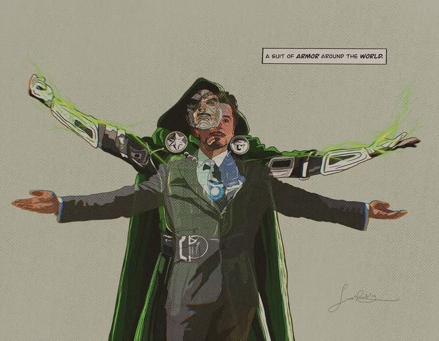

# Atharv Rajpoot | Personal Portfolio

<p align="center">
  
</p>

<h3 align="center">An Interactive Digital Portfolio</h3>

<p align="center">
  Showcasing my journey in Electrical Engineering, Robotics, Embedded Systems, and Artificial Intelligence.
</p>

<p align="center">
  
  
  
</p>

---

## About the Project

This repository contains my personal portfolio website, designed to showcase my technical interests, projects, skills, achievements, and experience.

The website combines a minimalist hacker-inspired interface with interactive animations, custom cursor effects, and a responsive layout to create a unique browsing experience.

Rather than being just a conventional portfolio, it serves as an interactive representation of my technical journey and ongoing exploration of technology.

## Features

- **Interactive Loading Screen:** Animated pixel-grid loading sequence that progressively reveals the profile image.
- **Custom Cursor System:** Multiple cursor styles, including crosshair, arrow, pixel trail, and customizable cursors.
- **Dark & Light Themes:** Switch between a black and neon-green interface and a warm, minimal light theme.
- **Responsive Design:** Layout adapts to different screen sizes and devices.
- **About Section:** Introduction, academic background, and technical interests.
- **Technical Skills:** Organized overview of programming, embedded systems, robotics, and engineering tools.
- **Projects Showcase:** Highlights hands-on engineering and development projects.
- **Experience & Achievements:** Dedicated sections for professional experience and accomplishments.
- **Contact Section:** Ways to connect and explore my work.

## Tech Stack

| Technology | Purpose |
|---|---|
| HTML5 | Website structure |
| CSS3 | Styling, animations, layouts, and themes |
| JavaScript | Interactions, cursor effects, and dynamic elements |
| Canvas API | Pixel-grid loading animation and visual effects |
| Local Storage | Saving theme and cursor preferences |
| Google Fonts | Typography |

## Project Structure

```text
portfolio/
│
├── index.html
├── style.css
├── script.js
├── loading-avatar.jpg
├── pfp_github.jpg
│
└── images/
    └── profile-about.png
```

## Run Locally

1. Clone this repository:

   ```bash
   git clone https://github.com/atharv-rajpoot/portfolio.git
   ```

2. Navigate to the project directory:

   ```bash
   cd portfolio
   ```

3. Open `index.html` in your browser.

   Alternatively, use the Live Server extension in Visual Studio Code.

## About Me

I am an Electrical Engineering student at the University of Mumbai, interested in exploring the intersection of electrical engineering and emerging technologies.

My areas of interest include:

- Robotics and Autonomous Systems
- Embedded Systems and Electronics
- Electrical and Power Systems
- Machine Learning and Artificial Intelligence
- Hardware Development and Experimentation

I enjoy learning through practical implementation, experimenting with hardware, and building projects that combine software and engineering.

## Connect With Me

- **GitHub:** [@atharv-rajpoot](https://github.com/atharv-rajpoot)

---

<p align="center">
  Designed and developed by <strong>Atharv Rajpoot</strong>
  <br/>
  <i>Building, experimenting, and learning one project at a time.</i>
</p>


# Atharv-Portfolio

Portfolio deployment managed through Vercel.

